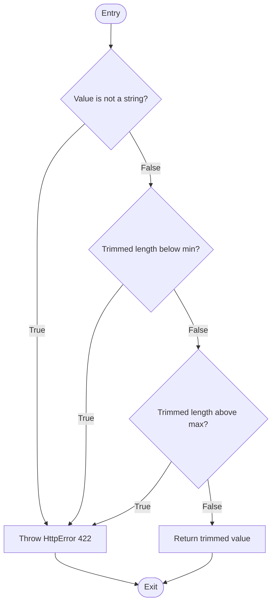
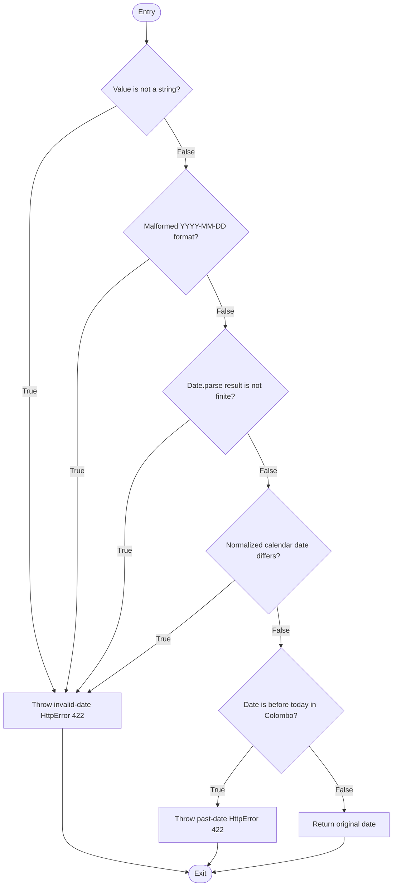

# Control-flow graphs and cyclomatic complexity

Source: `server/src/validation.js`, functions `text()` and `dateOnly()`.
These functions were inspected in the supplied baseline and remained the selected
white-box targets during the recorded QA work.

## Counting convention

Each short-circuit Boolean operand is a separate decision because it changes the
execution path. Each function is one connected component, P = 1. Default-argument
evaluation and the internal decisions of called library/helper functions are
outside these graphs. All normal and exceptional exits join a single exit node.

## text(): 7 nodes, 9 edges, complexity 4

`V(G) = E - N + 2P = 9 - 7 + 2 = 4`.
Equivalently: 3 decisions + 1 = 4.

| Independent path | Example or test purpose |
|---|---|
| A-B-E-G | A non-string input is rejected before trim() is called |
| A-B-C-E-G | A string shorter than the minimum after trimming is rejected |
| A-B-C-D-E-G | A string longer than the maximum is rejected |
| A-B-C-D-F-G | A valid string is trimmed and returned |

Traceability: M2-T01 through M2-T04 in `server/test/qa-validation.test.js`.
Boundary assertions include the accepted minimum/maximum and rejected outside values.

## dateOnly(): 10 nodes, 14 edges, complexity 6

`V(G) = E - N + 2P = 14 - 10 + 2 = 6`.
Equivalently: 5 decisions + 1 = 6.

| Independent path | Example or test purpose |
|---|---|
| A-B-F-J | Non-string input |
| A-B-C-F-J | Invalid textual format |
| A-B-C-D-F-J | Correct textual shape but an unparseable date |
| A-B-C-D-E-F-J | A date that JavaScript normalizes to another calendar day |
| A-B-C-D-E-G-H-J | A valid calendar date that is in the past |
| A-B-C-D-E-G-I-J | Today or a future date is returned unchanged |

Traceability: M2-T05 through M2-T10 in `server/test/qa-validation.test.js`.
The overall file coverage percentages also include other functions in validation.js;
they are not automatically the coverage of either individual graph.
